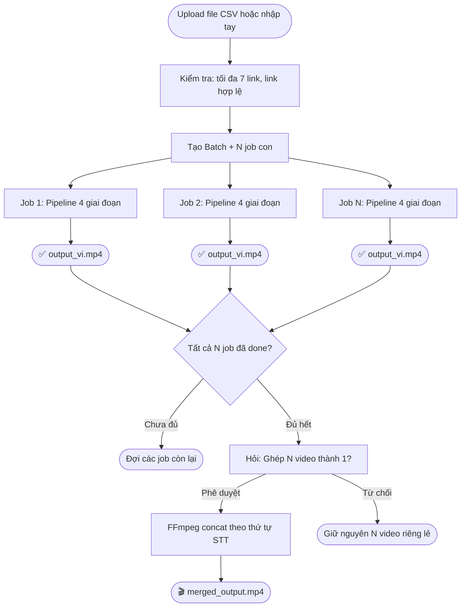

# 🎬 Batch Video Processing & Concatenation

## Tổng quan ý tưởng

Mở rộng hệ thống hiện tại — hiện chỉ xử lý **1 video/lần** — thành hệ thống **xử lý hàng loạt (batch)** với khả năng **ghép nối các video đầu ra thành 1 video duy nhất**.

### Luồng người dùng mới

```
┌──────────────────────────────────────────────────────────────────┐
│  Trang chủ: 2 chế độ nhập liệu (Tab hoặc Toggle)               │
│                                                                  │
│  [Tab 1: Video đơn]          [Tab 2: Batch — Nhiều video]        │
│                                                                  │
│  Tab 2:                                                          │
│  ┌────────────────────────────────────┐                          │
│  │  📎 Upload file CSV/Excel          │                          │
│  │     hoặc                           │                          │
│  │  📝 Nhập tay bảng (max 7 dòng)    │                          │
│  └────────────────────────────────────┘                          │
│                                                                  │
│  Bảng xem trước:                                                 │
│  ┌─────┬──────────────────────────────────────────┐              │
│  │ STT │ Link video                               │              │
│  ├─────┼──────────────────────────────────────────┤              │
│  │  1  │ https://youtube.com/watch?v=aaa           │              │
│  │  2  │ https://douyin.com/video/bbb              │              │
│  │  3  │ https://tiktok.com/@user/video/ccc        │              │
│  └─────┴──────────────────────────────────────────┘              │
│                                                                  │
│  ⚙️ Cài đặt chung (giọng, ngôn ngữ, âm lượng, phân giải)       │
│  [Xử lý batch]                                                   │
└──────────────────────────────────────────────────────────────────┘
```

### Pipeline xử lý batch



---

## Kiến trúc kỹ thuật

### Khái niệm mới: **Batch**

Batch là một nhóm job được tạo cùng lúc, có quan hệ cha-con:

| Entity | Vai trò |
|---|---|
| **Batch** | Nhóm chứa nhiều job, theo dõi tiến độ tổng, quyết định ghép video |
| **Job** (không đổi) | Xử lý 1 video đơn lẻ qua 4 giai đoạn như cũ |

### Schema bảng mới: `batches`

```sql
CREATE TABLE IF NOT EXISTS batches (
    id            TEXT PRIMARY KEY,         -- uuid
    status        TEXT DEFAULT 'processing',-- processing | awaiting_merge | merging | done | error
    total_jobs    INTEGER NOT NULL,         -- số job con (1-7)
    done_jobs     INTEGER DEFAULT 0,        -- đếm job đã done
    merge_approved INTEGER,                 -- NULL = chưa hỏi, 1 = ghép, 0 = không ghép
    folder        TEXT,                     -- thư mục batch: downloads/web/batch_<id>/
    error         TEXT,
    created_at    TEXT,
    updated_at    TEXT
);
```

### Thay đổi bảng `jobs` (thêm cột)

```sql
ALTER TABLE jobs ADD COLUMN batch_id TEXT;       -- NULL nếu job đơn lẻ, uuid nếu thuộc batch
ALTER TABLE jobs ADD COLUMN batch_order INTEGER; -- thứ tự STT trong batch (1-based), dùng để ghép
```

---

## Chi tiết từng giai đoạn

### Giai đoạn 0 — Nhập liệu & Tạo batch

**Frontend:**
- Thêm Tab/Toggle "Batch — Nhiều video" trên trang chủ ([page.tsx](file:///c:/Python/yeutube/frontend/src/app/page.tsx)).
- Cho phép:
  - **Upload file**: Chấp nhận `.csv` (2 cột: STT, Link) — parse ở frontend, không cần thư viện nặng.
  - **Nhập tay**: Hiển thị bảng editable có nút ➕ thêm dòng / 🗑️ xóa dòng. Giới hạn tối đa 7 dòng.
- Validate: kiểm tra link không trống, không trùng, tối đa 7.
- Các cài đặt chung (giọng đọc, ngôn ngữ, âm lượng, phân giải) **áp dụng cho tất cả video trong batch** — giống form hiện tại.

**Backend:**
- API mới: `POST /api/batches` nhận mảng link + cài đặt chung → tạo 1 batch + N job con.
- Mỗi job con tạo riêng trong bảng `jobs` (có `batch_id` + `batch_order`), chạy pipeline cũ y nguyên.

### Giai đoạn 1–4 — Xử lý từng video & Cơ chế chạy song song (Parallel Processing)

Mỗi job con chạy đúng pipeline hiện tại:
1. **Tải video** (`run_stage1_download`)
2. **User vẽ box che + đặt phụ đề** (awaiting_masks → awaiting_layout)
3. **Máy STT → Dịch → TTS** (`run_prep` — chạy song song với bước 2)
4. **Render** (`maybe_render` → `_render`)

#### ⚙️ Cài đặt chung cho cả Batch (Shared Settings)
- Người dùng chỉ thiết lập **1 lần duy nhất** tại form tạo Batch:
  - Giọng đọc TTS (voice, tốc độ, cao độ).
  - Ngôn ngữ dịch (target language).
  - Tỉ lệ âm lượng (gốc vs thuyết minh).
  - Độ phân giải mong muốn.
- Tất cả các job trong batch **tự động kế thừa cấu hình chung này**, không cần cấu hình lặp lại cho từng video.

#### ⚡ Cơ chế chạy song song ngầm (Parallel Pipeline)
- **Tải video (Download):** Chạy song song ngay lập tức cho cả 5–7 video khi vừa tạo batch.
- **Xử lý AI & Render ngầm:** 
  - Trong lúc user đang vẽ mask cho Video 1, các Video 2, 3, 4 đã tự động tải xong và chạy ngầm STT (Whisper), Dịch thuật, tạo giọng đọc (TTS).
  - Sau khi user xác nhận layout của Video 1, Video 1 tự render ngầm; user chuyển sang Video 2 thì Video 2 đã chuẩn bị sẵn sàng toàn bộ tài nguyên.
- **Điều tiết tài nguyên (Concurrency Control):** Dùng `asyncio.Semaphore` (giới hạn tối đa 2–3 tác vụ AI / FFmpeg Render nặng chạy đồng thời) để tránh tràn RAM/VRAM hoặc đơ máy, các tác vụ còn lại sẽ xếp hàng tự động.

#### 🎨 Luồng thao tác Masks & Layout (Wizard Step-by-Step)
> [!IMPORTANT]
> **Thao tác lần lượt + Tự động Next:**
> 1. Hệ thống mở giao diện tương tác cho Video 1 (`awaiting_masks` → `awaiting_layout`).
> 2. Khi user bấm **"Xác nhận Video 1"** $\rightarrow$ Hệ thống tự động chuyển tiếp sang Video 2 đã sẵn sàng.
> 3. **Tùy chọn tiện ích "Áp dụng cho tất cả":** Cung cấp nút tick/nút bấm *"Áp dụng vùng che & vị trí sub này cho tất cả video còn lại"* — cực kỳ hữu ích khi cào nhiều video cùng một kênh Douyin/TikTok (cùng tỉ lệ khung hình và vị trí logo/sub).
> 4. **Không khóa màn hình:** Giao diện có thanh tiến độ `Video X / N` kèm nút *"Quay về trang Batch"*, cho phép user thoát ra nghỉ bất cứ lúc nào mà không làm gián đoạn các tiến trình ngầm.

### Giai đoạn 5 — Ghép video (MỚI)

Khi tất cả job trong batch đạt `status=done`:
- Backend cập nhật `batch.status = 'awaiting_merge'`.
- Frontend hiện thông báo:
  > "✅ Tất cả 5 video đã xử lý xong! Bạn có muốn ghép thành 1 video không?"
  >
  > [Ghép video]  [Giữ riêng lẻ]
  
- Nếu user bấm **Ghép video** → Backend chạy FFmpeg concat:
  ```bash
  # Bước 1: Tạo file danh sách
  # concat_list.txt:
  # file 'job_1/output_vi.mp4'
  # file 'job_2/output_vi.mp4'
  # ...
  
  # Bước 2: Ghép (re-encode để đảm bảo tương thích codec/resolution giữa các video)
  ffmpeg -y -f concat -safe 0 -i concat_list.txt \
    -c:v libx264 -preset veryfast -crf 20 \
    -c:a aac -b:a 192k \
    merged_output.mp4
  ```
- Nếu video có kích thước/tỉ lệ khác nhau (vd. video ngang + video dọc) → cần scale + pad về cùng 1 chuẩn trước khi ghép:
  ```bash
  # Scale + pad tất cả về 1920x1080 (hoặc 1080x1920 nếu batch toàn video dọc)
  ffmpeg -y \
    -i job_1/output_vi.mp4 \
    -i job_2/output_vi.mp4 \
    -i job_3/output_vi.mp4 \
    -filter_complex "
      [0:v]scale=1920:1080:force_original_aspect_ratio=decrease,pad=1920:1080:(ow-iw)/2:(oh-ih)/2[v0];
      [1:v]scale=1920:1080:force_original_aspect_ratio=decrease,pad=1920:1080:(ow-iw)/2:(oh-ih)/2[v1];
      [2:v]scale=1920:1080:force_original_aspect_ratio=decrease,pad=1920:1080:(ow-iw)/2:(oh-ih)/2[v2];
      [v0][0:a][v1][1:a][v2][2:a]concat=n=3:v=1:a=1[vout][aout]
    " \
    -map "[vout]" -map "[aout]" \
    -c:v libx264 -preset veryfast -crf 20 \
    -c:a aac -b:a 192k \
    merged_output.mp4
  ```

---

## Cấu trúc thư mục đầu ra

```
downloads/web/
├── <job_id_1>/           # Job đơn lẻ (như hiện tại, không đổi)
│   ├── index.mp4
│   ├── output_vi.mp4
│   └── ...
│
├── batch_<batch_id>/     # Batch folder
│   ├── concat_list.txt   # Danh sách file cho ffmpeg concat
│   └── merged_output.mp4 # Video đã ghép
│
├── <job_id_a>/           # Job con #1 của batch
│   ├── index.mp4
│   ├── output_vi.mp4
│   └── ...
├── <job_id_b>/           # Job con #2 của batch
│   ├── index.mp4
│   ├── output_vi.mp4
│   └── ...
└── ...
```

---

## API Endpoints mới

| Method | Endpoint | Mô tả |
|---|---|---|
| `POST` | `/api/batches` | Tạo batch mới (nhận mảng links + settings) |
| `GET` | `/api/batches` | Liệt kê các batch gần đây |
| `GET` | `/api/batches/{batch_id}` | Chi tiết batch + danh sách job con |
| `POST` | `/api/batches/{batch_id}/merge` | User phê duyệt ghép video |
| `POST` | `/api/batches/{batch_id}/skip-merge` | User chọn không ghép |

---

## Trang Frontend mới

| Trang | Mô tả |
|---|---|
| `page.tsx` (sửa) | Thêm Tab batch, form upload CSV / nhập tay bảng |
| `/batches/[id]/page.tsx` (mới) | Trang theo dõi batch: hiện bảng N job + status từng cái, nút ghép khi tất cả done |

---

## Chia task triển khai

### Phase 1 — Backend: Batch Store & API (Ưu tiên cao)

| Task | File cần sửa/tạo | Mô tả | Ước lượng |
|---|---|---|---|
| **T1.1** | [jobs_store.py](file:///c:/Python/yeutube/backend/jobs_store.py) | Thêm bảng `batches` vào schema, hàm CRUD cho batch (`create_batch`, `get_batch`, `list_batches`, `update_batch`) | 1h |
| **T1.2** | [jobs_store.py](file:///c:/Python/yeutube/backend/jobs_store.py) | Thêm cột `batch_id` + `batch_order` vào bảng `jobs`, sửa `_create_job_sync` nhận 2 trường mới | 30m |
| **T1.3** | [schemas.py](file:///c:/Python/yeutube/backend/api/schemas.py) | Thêm Pydantic models: `BatchCreate`, `BatchOut`, `BatchJobItem` | 30m |
| **T1.4** | Tạo mới: `backend/api/routers/batches.py` | Router xử lý 5 endpoints batch (CRUD + merge + skip-merge) | 1.5h |
| **T1.5** | [pipeline.py](file:///c:/Python/yeutube/backend/api/pipeline.py) | Sửa cuối hàm `_render`: sau khi job done, kiểm tra nếu job thuộc batch → gọi `check_batch_completion(batch_id)` | 30m |

### Phase 2 — Backend: Concat Engine (Ưu tiên cao)

| Task | File cần sửa/tạo | Mô tả | Ước lượng |
|---|---|---|---|
| **T2.1** | Tạo mới: `backend/concat.py` | Hàm `concat_videos(job_folders, output_path)`: tạo concat_list.txt, gọi ffmpeg concat, xử lý trường hợp resolution khác nhau (scale+pad) | 2h |
| **T2.2** | [pipeline.py](file:///c:/Python/yeutube/backend/api/pipeline.py) hoặc tạo `batch_pipeline.py` | Hàm `run_merge(batch_id)`: lấy danh sách job theo `batch_order`, gọi `concat_videos`, cập nhật batch status | 1h |

### Phase 3 — Frontend: Form batch trên trang chủ (Ưu tiên trung bình)

| Task | File cần sửa/tạo | Mô tả | Ước lượng |
|---|---|---|---|
| **T3.1** | [page.tsx](file:///c:/Python/yeutube/frontend/src/app/page.tsx) | Thêm Toggle/Tab chuyển giữa "Video đơn" và "Batch" | 1h |
| **T3.2** | Tạo mới: `frontend/src/components/BatchInputTable.tsx` | Component bảng nhập tay: thêm/xóa dòng, validate link, hiện STT tự động, giới hạn 7 dòng | 2h |
| **T3.3** | Tạo mới: `frontend/src/components/CsvUploader.tsx` | Component upload + parse file CSV (dùng FileReader API, không cần thư viện ngoài), hiện preview dữ liệu | 1.5h |
| **T3.4** | [api.ts](file:///c:/Python/yeutube/frontend/src/lib/api.ts) | Thêm types + hàm gọi API cho batch (`createBatch`, `getBatch`, `listBatches`, `approveMerge`, `skipMerge`) | 30m |
| **T3.5** | [page.tsx](file:///c:/Python/yeutube/frontend/src/app/page.tsx) | Gắn form batch submit: gọi `createBatch` → redirect đến `/batches/[id]` | 30m |

### Phase 4 — Frontend: Trang theo dõi batch (Ưu tiên trung bình)

| Task | File cần sửa/tạo | Mô tả | Ước lượng |
|---|---|---|---|
| **T4.1** | Tạo mới: `frontend/src/app/batches/[id]/page.tsx` | Trang batch detail: bảng hiện N job + status/progress từng job, link đến trang job chi tiết | 2h |
| **T4.2** | Trang batch (tiếp) | Logic polling + auto-refresh, phát hiện khi tất cả job done → hiện prompt ghép video | 1h |
| **T4.3** | Trang batch (tiếp) | Nút "Ghép video" / "Giữ riêng lẻ", gọi API merge/skip-merge, hiện progress ghép + link tải video đã ghép | 1h |
| **T4.4** | [page.tsx](file:///c:/Python/yeutube/frontend/src/app/page.tsx) | Section "Batch gần đây" bên dưới "Job gần đây" trên trang chủ | 30m |

### Phase 5 — Polish & Edge Cases (Ưu tiên thấp)

| Task | Mô tả | Ước lượng |
|---|---|---|
| **T5.1** | Retry cho batch: nếu 1 job lỗi, cho phép retry riêng job đó mà không ảnh hưởng batch | 1h |
| **T5.2** | Xử lý edge case: video có tỉ lệ khung hình khác nhau khi concat (ngang + dọc) → tự detect + chọn chiến lược scale/pad phù hợp | 1h |
| **T5.3** | Trang batch hiện **video player preview** cho merged_output.mp4 sau khi ghép xong | 30m |
| **T5.4** | UX: Khi user thao tác masks/layout cho batch, tự động điều hướng sang job tiếp theo chưa xong sau khi xác nhận job hiện tại | 1h |

---

## Tổng ước lượng

| Phase | Nội dung | Thời gian |
|---|---|---|
| Phase 1 | Backend: Batch Store & API | ~4h |
| Phase 2 | Backend: Concat Engine | ~3h |
| Phase 3 | Frontend: Form batch | ~5.5h |
| Phase 4 | Frontend: Trang batch | ~4.5h |
| Phase 5 | Polish & Edge Cases | ~3.5h |
| **Tổng** | | **~20.5h** |

---

## Thứ tự triển khai đề xuất

```mermaid
gantt
    title Lộ trình triển khai Batch Video
    dateFormat X
    axisFormat %s
    
    section Phase 1 - Backend Store
    T1.1 Bảng batches + CRUD           :t11, 0, 60
    T1.2 Thêm cột batch vào jobs       :t12, 60, 30
    T1.3 Pydantic schemas              :t13, 90, 30
    T1.4 Router batches.py             :t14, 120, 90
    T1.5 Hook batch check vào pipeline :t15, 210, 30

    section Phase 2 - Concat
    T2.1 concat.py (ffmpeg)            :t21, 240, 120
    T2.2 run_merge pipeline            :t22, 360, 60

    section Phase 3 - Frontend Form
    T3.1 Tab toggle                    :t31, 420, 60
    T3.2 BatchInputTable component     :t32, 480, 120
    T3.3 CsvUploader component         :t33, 480, 90
    T3.4 API client batch              :t34, 600, 30
    T3.5 Submit + redirect             :t35, 630, 30

    section Phase 4 - Batch Page
    T4.1 Batch detail page             :t41, 660, 120
    T4.2 Polling + auto-refresh        :t42, 780, 60
    T4.3 Merge prompt UI               :t43, 840, 60
    T4.4 Batch list trên homepage      :t44, 900, 30

    section Phase 5 - Polish
    T5.1 Retry job trong batch         :t51, 930, 60
    T5.2 Mixed aspect ratio            :t52, 990, 60
    T5.3 Video preview merged          :t53, 1050, 30
    T5.4 Auto-navigate next job        :t54, 1080, 60
```



> [!TIP]
> **Có thể bắt đầu triển khai ngay Phase 1 → Phase 2 → Phase 3 → Phase 4** theo thứ tự. Phase 5 làm sau khi đã chạy được end-to-end.

---

## Nguyên tắc thiết kế

1. **Không sửa pipeline đơn lẻ hiện có** — batch chỉ là lớp orchestration bọc ngoài, mỗi job con vẫn chạy đúng 4 giai đoạn cũ.
2. **Giới hạn 7 video/batch** — kiểm soát tài nguyên server và đảm bảo tính ổn định.
3. **Xử lý ngầm song song có điều tiết (Semaphore)** — Các job con tải video, chạy STT/Dịch/TTS và Render ngầm độc lập song song. Sử dụng Semaphore (tối đa 2–3 tác vụ AI/Render đồng thời) để tối ưu thời gian chờ mà vẫn đảm bảo an toàn tài nguyên máy (tránh OOM/đơ CPU).
4. **Cài đặt chung cho cả batch** — giọng đọc, ngôn ngữ, âm lượng, phân giải áp cho tất cả video. Không bắt buộc cài đặt riêng từng video (giữ UX tinh gọn, nhanh chóng).
5. **Thao tác Mask/Layout gối đầu linh hoạt** — Wizard tự chuyển sang video tiếp theo, có nút "Áp dụng cho tất cả video còn lại" và có thể quay về trang tổng quan batch bất kỳ lúc nào.
6. **Ghép video là bước tùy chọn** — user có quyền phê duyệt hoặc từ chối để giữ các video riêng lẻ.
